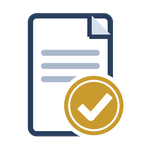

# Masovni PDF Potpis

Besplatna Windows aplikacija za **masovno digitalno potpisivanje PDF dokumenata** kvalifikovanim elektronskim certifikatom (USB token, pametna kartica ili certifikat instaliran u Windows), s **vidljivim pečatom** u istom stilu kao Adobe Acrobat.

Napravljena za računovođe i firme u Bosni i Hercegovini koji svakodnevno potpisuju veliki broj dokumenata (nalozi za knjiženje, platne liste, odluke…), ali radi s bilo kojim certifikatom koji Windows vidi.



## Šta radi

- **Pregled foldera** – izabereš folder (s podfolderima) i odmah vidiš za svaki PDF: da li je potpisan, ko ga je potpisao, kada, kojim certifikatom, ima li vidljiv pečat i da li je dokument mijenjan nakon potpisa.
- **Provjera potpisa** – kriptografska provjera svakog potpisa u dokumentu (ispravan / mijenjan / neispravan) i podaci o certifikatu (izdavač, namjena ključa, važenje).
- **Pozicija pečata mišem** – na pregledu stranice klikneš gdje ide pečat (ili povučeš pravougaonik za veličinu); pozicija se pamti.
- **Mjesto pečata** – zadnja stranica, prva stranica ili **nova stranica na kraju** dokumenta.
- **Masovno potpisivanje** – svi označeni dokumenti jednim klikom; PIN se unosi u prozoru drivera tokena.
- **Dodavanje potpisa** – već potpisan dokument dobije dodatni potpis s pečatom, a postojeći potpisi ostaju važeći.
- **Vremenski žig (opcija)** – uz potpis se ugradi vremenski žig (RFC 3161) i podatak o statusu certifikata (OCSP), pa je vrijeme potpisa dokazivo nezavisno od sata računara, a potpis provjerljiv i nakon isteka certifikata.
- **Dnevnik potpisivanja** – svaki potpis se upisuje u `_dnevnik_potpisivanja.csv` u izabranom folderu (vrijeme, fajl, certifikat, Windows korisnik, SHA-256 otisak prije i poslije potpisa). Otvara se u Excelu.
- **Jezik** – bosanski/hrvatski/srpski (latinica) ili engleski; automatski prema jeziku Windowsa ili ručno (*Jezik / Language* u gornjoj traci).
- **Sigurno** – prije zamjene originala svaki potpisani fajl se provjeri; originali se čuvaju u `_backup_<datum>` (ili se potpisane kopije spremaju u `_potpisano`). Ako bilo šta ne uspije, original ostaje netaknut.

## Instalacija

1. Instaliraj **.NET 8 Desktop Runtime** (jednom):
   ```
   winget install Microsoft.DotNet.DesktopRuntime.8
   ```
2. Preuzmi `MasovniPdfPotpis.zip` iz [Releases](https://github.com/BukiSP84/masovni-pdf-potpis/releases), raspakuj i pokreni `MasovniPdfPotpis.exe`.
   Ako Windows prikaže „Windows protected your PC“: **More info → Run anyway**.
3. Softver za tvoj token/karticu (npr. Halcom) mora biti instaliran – certifikat se mora vidjeti u Windowsu (`certmgr.msc` → Personal → Certificates).

## Upotreba

1. **Izaberi folder…** – lista PDF-ova sa statusom. Nepotpisani su automatski označeni.
2. Klikni dokument → desno je pregled stranice. Klik/povlačenje = mjesto pečata.
3. Izaberi **certifikat** (potpisni certifikat s namjenom *NonRepudiation* je ponuđen prvi) i **način spremanja**.
4. Po želji uključi **Vremenski žig** (traži internet).
5. **Potpiši označene** → pregledaj spisak, označi izjavu „Pregledao/la sam ove dokumente i potpisujem ih svojom voljom“ → **Potpiši** → unesi PIN kad driver zatraži.

### Vremenski žig

Zadana adresa je `http://timestamp.digicert.com` – besplatan javni servis koji Adobe Reader prepoznaje. To **nije** kvalifikovani vremenski žig u smislu bh. propisa. Ako vaš izdavač certifikata (npr. Halcom, IDDEEA, BH Pošta) nudi uslugu vremenskog žiga, upišite njegovu adresu u polje pored opcije. Servisu se šalje samo kriptografski otisak (hash) dokumenta, nikad sam dokument.

Postavke se čuvaju u `%APPDATA%\MasovniPdfPotpis\postavke.json`.

## Pravna napomena

Ovo nije pravni savjet. Ukratko, za korisnike u BiH:

- Aplikacija pravi **elektronski potpis fizičkog lica** – vlasnika certifikata. To **nije elektronski pečat pravnog lica** (firme). Vidljivi „pečat“ na stranici je samo prikaz potpisa.
- Punu pravnu snagu, jednaku vlastoručnom potpisu, u pravilu ima **kvalifikovani elektronski potpis** – certifikat ovlaštenog izdavača na tokenu ili kartici.
- Potpisnik mora sam odlučiti o potpisu i imati sredstvo za potpis pod isključivom kontrolom. Zato aplikacija prije svakog potpisivanja prikazuje spisak dokumenata i traži izjavu potpisnika, a PIN unosi isključivo potpisnik u prozoru drivera. **Potpisuj samo dokumente koje si pregledao/la.** Nikad ne koristi tuđi certifikat.
- **Nije namijenjena** aktima koji traže notarsku ili sudsku formu, vlastoručni potpis ili fizički pečat. Primjeri: promet nekretnina, bračni imovinski ugovori, registracijske prijave, otkupni blokovi, papirne knjige obrta. Za ugovore o radu, anekse i otkaze praksa nije ujednačena, pa je oprez preporučljiv.
- Da li primalac (institucija, banka, druga strana) prihvata elektronski potpisan dokument, provjeri kod primaoca.
- Potpisane dokumente **čuvaj u elektronskom obliku** (ispis na papir nije original), zajedno s dnevnikom potpisivanja. Za dugoročnu provjerljivost preporučuje se opcija **Vremenski žig**.

Propisi se razlikuju između države, FBiH, RS i Brčko distrikta i mijenjaju se. Za konkretan slučaj pitaj stručnjaka.

## Da potpisi u Adobe Readeru budu „zeleni“

Adobe Reader → `Ctrl+K` → **Signatures** → *Verification* → **More…**:
- uključi **Verify signatures when the document is opened**
- pod **Windows Integration** uključi **Validating signatures** i **Validating certified documents**

Tako Adobe vjeruje root certifikatima iz Windowsa (koje instalira softver izdavača certifikata).

## Izgradnja iz izvornog koda

Potreban je .NET 8 SDK.

```
cd App
dotnet publish -c Release -r win-x64 --self-contained false -p:PublishSingleFile=true -p:IncludeNativeLibrariesForSelfExtract=true
```

Struktura:
- `Core/` – potpisivanje (iText), izgled pečata, provjera potpisa, masovna obrada
- `App/` – Windows Forms aplikacija (lista, pregled stranice, pozicija pečata)
- `Test/` – konzolni test s `.pfx` certifikatom

## Licenca

Copyright © 2026 Samir Perenda

Ovaj program je slobodan softver pod licencom **GNU Affero General Public License v3.0** (vidi [LICENSE](LICENSE)). Program se daje **bez ikakve garancije**. Korisnik je odgovoran za provjeru potpisanih dokumenata.

Korištene biblioteke i njihove licence: [THIRD-PARTY-NOTICES.md](THIRD-PARTY-NOTICES.md). iText® je registrovani znak kompanije Apryse Group NV; ovaj projekat nije povezan s Apryse niti s Adobe.

## Microsoft Store paket (MSIX)

Manifest je u `Paket/AppxManifest.xml`. Paket se pravi od self-contained izdanja:

```
cd App
dotnet publish -c Release -r win-x64 --self-contained true -o ../msix/app
# u ../msix kopirati Paket/AppxManifest.xml i slike iz App/Resursi u ../msix/Images
makeappx pack /d ../msix /p MasovniPdfPotpis.msix      # ili makemsix na Linuxu
```

Izjava o privatnosti: [PRIVACY.md](PRIVACY.md)
